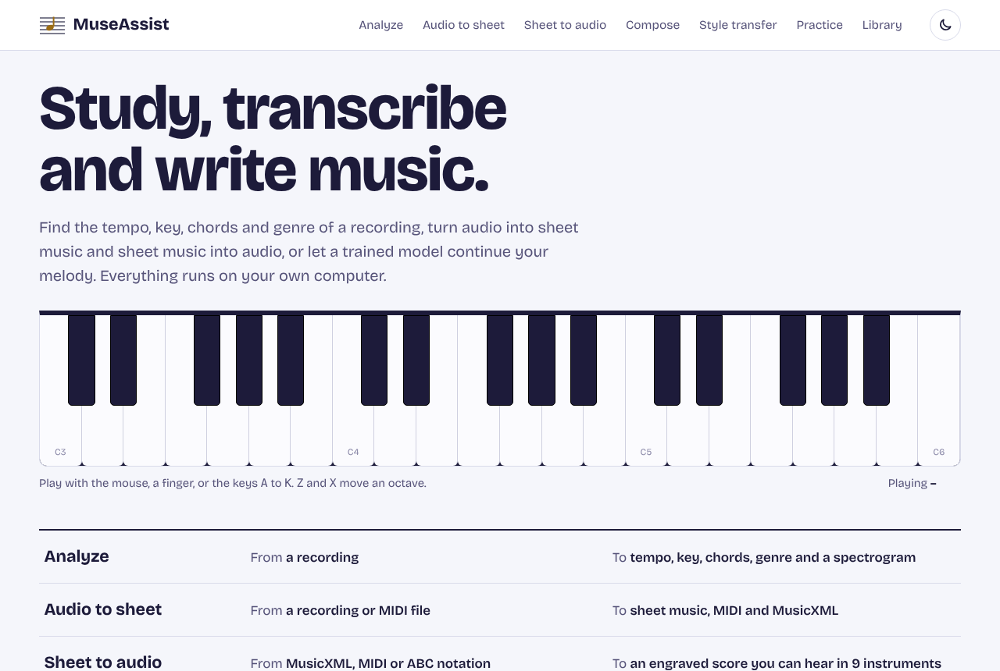
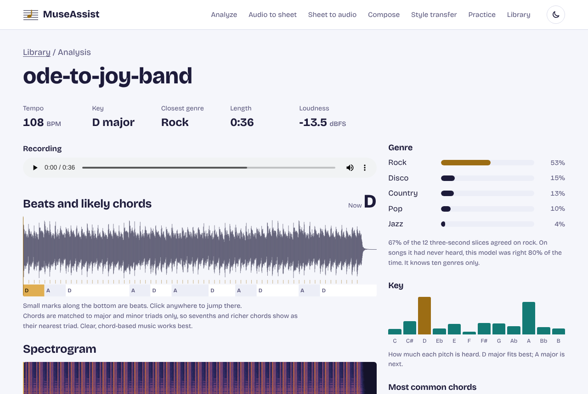
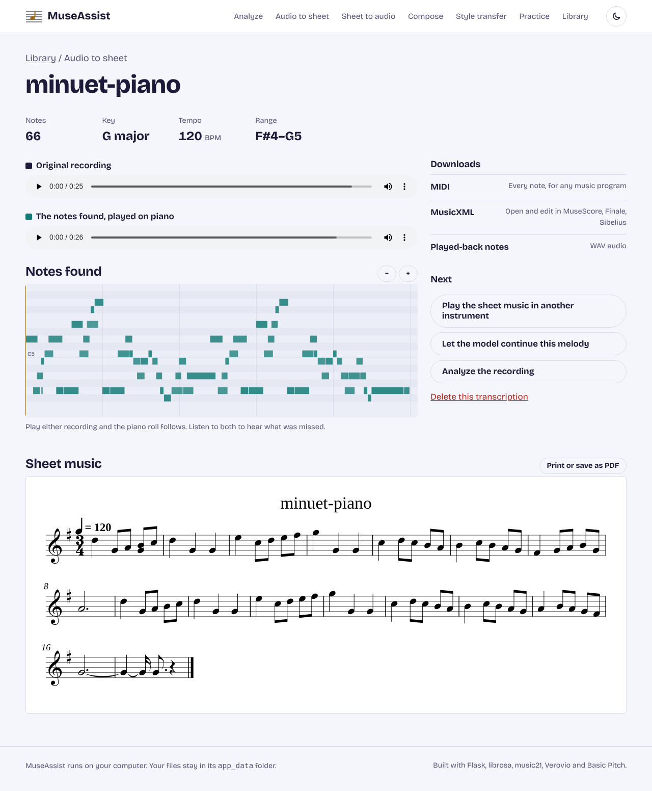
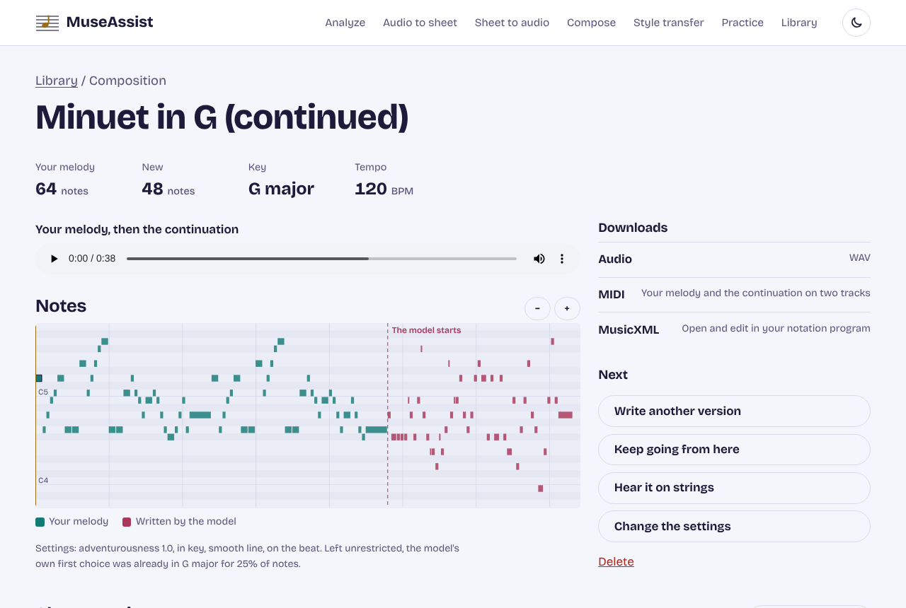
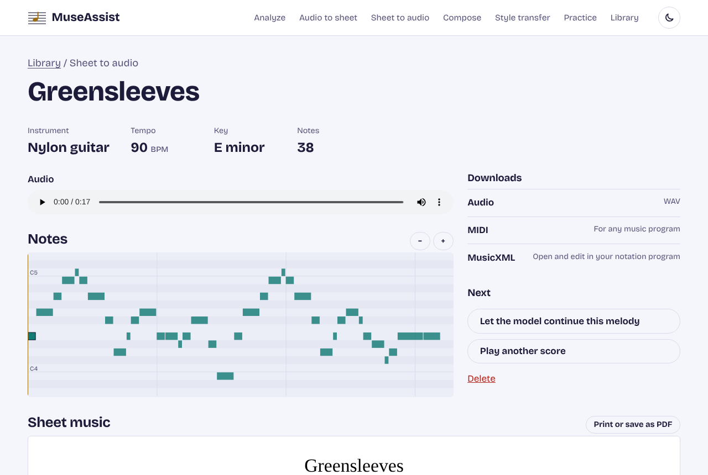
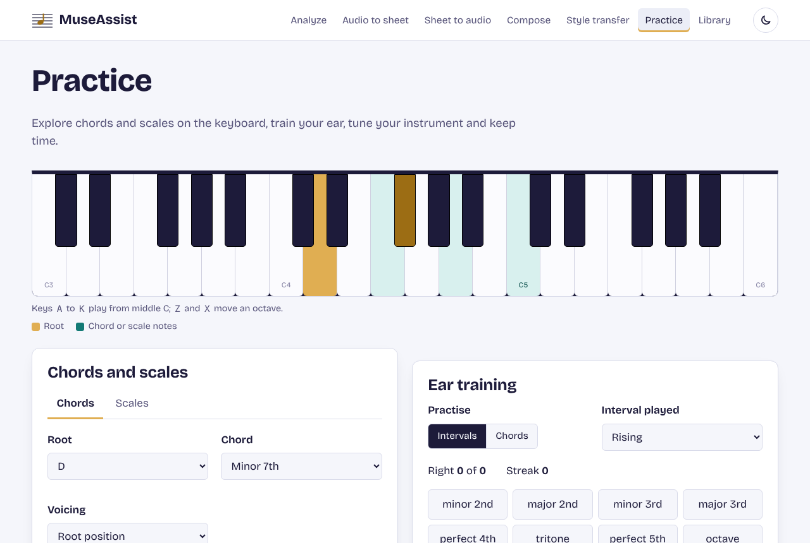
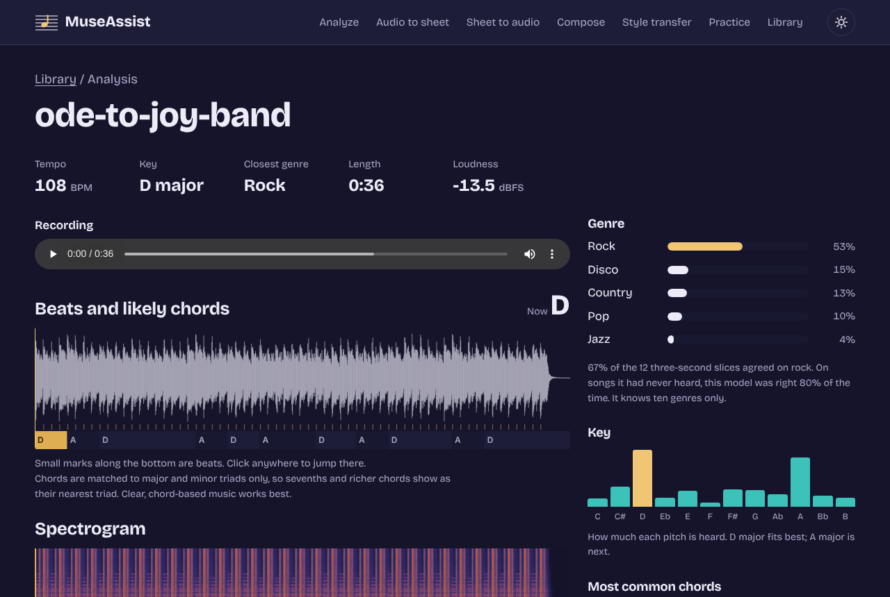
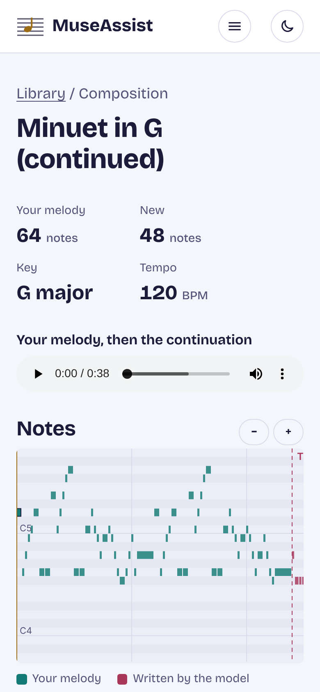

# MuseAssist

A music study and creation app. Analyze a recording (tempo, key, chords, genre), turn audio
into sheet music and sheet music into audio, let a trained model continue a melody, restyle
one recording with the sound of another, and practise with a playable piano, ear training,
a tuner and a metronome. Flask backend, plain HTML/CSS/JS frontend, everything runs on your
own computer.



| Analysis | Audio to sheet music |
|---|---|
|  |  |

| Compose | Sheet to audio | Practice |
|---|---|---|
|  |  |  |

| Dark theme | Phone |
|---|---|
|  |  |

## Run it

You need Python 3.10 or newer.

```
git clone https://github.com/Mayuresh1134/Major_Project_New.git
cd Major_Project_New
python -m venv .venv
.venv\Scripts\activate            # Windows.   macOS/Linux: source .venv/bin/activate
pip install -r requirements.txt
python app.py
```

Open http://127.0.0.1:5000.

Nothing else is needed: no MuseScore, no SoundFont, no TensorFlow or PyTorch. Your uploads
and results are kept in `app_data/` (git ignores it); the Library page lists them.

Settings, all optional, as environment variables:

| Setting | Default | What it does |
|---|---|---|
| `MUSE_PORT` / `MUSE_HOST` | `5000` / `127.0.0.1` | Where the app listens |
| `MUSE_DATA_DIR` | `app_data` | Where results are stored |
| `MUSE_MAX_UPLOAD_MB` | `60` | Largest upload |
| `MUSE_MAX_RESULTS` | `200` | Older results are removed beyond this |
| `MUSE_DEBUG` | off | `1` turns on Flask debug mode |

For General MIDI instrument sounds in "Sheet to audio", install the FluidSynth program and
put a `.sf2` SoundFont in `soundfonts/`. Without it the built-in synthesizer is used.

## What's in it

| Screen | What it does |
|---|---|
| Analyze | Tempo with every beat marked, key (and how clear it is), likely chords shown in time with playback, the closest of ten genres with confidences, loudness, dynamic range, tone and a spectrogram. |
| Audio to sheet | Finds the notes in a recording (or reads a MIDI file) and engraves them as sheet music, with a key signature, a time signature you choose and a fitted tempo. Plays the found notes back next to the original so you can hear what was missed. Downloads: MIDI, MusicXML, WAV; print or save the sheet as PDF. "Melody only" keeps the top line. |
| Sheet to audio | Plays MusicXML (`.musicxml`, `.mxl`), MIDI or ABC notation, typed in or uploaded, at any speed from 25% to 300%, transposed up to an octave either way, in nine instruments or "as written". Shows the engraved score and a piano roll that follows playback. |
| Compose | Continues a melody with the trained LSTM: from four public-domain tunes, an upload, typed ABC, or any earlier result. Options: length, adventurousness (temperature), stay in key, smooth line (no leaps beyond a sixth), keep to the beat, a variation number for repeatable results. The piano roll shows your notes and the model's in different colours. |
| Style transfer | Reshapes one clip's spectrogram so its texture matches another's, with a strength slider and three quality levels, and shows all three spectrograms. |
| Practice | A three-octave piano (mouse, touch or computer keys), 15 chord types in any key and inversion, 13 scales and modes, ear training for intervals and chords with a score and streak, a microphone tuner with adjustable A4, and a metronome with tap tempo and accents. |
| Library | Every result, filterable by tool; open or delete any of them. |

Results link into each other: an analysis can become sheet music, a transcription can be
played in another instrument or continued by the model, and a composition can keep going.

Light and dark themes, layouts for phones, keyboard focus styles, and reduced motion when
the device asks for it.

## The models

### Genre

**Data:** GTZAN, 1,000 songs of 30 seconds in ten genres, as the "features_3_sec" table
(57 numbers per 3-second slice: chroma, loudness, spectral shape, zero crossings, harmonic
and percussive energy, tempo, 20 MFCCs). The app computes the same 57 numbers from your
audio with librosa; on GTZAN clips they match the table to three or four significant figures.

**Test:** 5-fold cross-validation grouped by song, so every song is scored by a model that
never heard any part of it.

| Model | Songs right |
|---|---|
| 13 MFCC averages over 30 s, neural network (the first version's approach) | 56.4% ± 3.9 |
| 57 features per slice, logistic regression, averaged over slices | 74.0% ± 1.8 |
| **57 features per slice, three neural networks, averaged over slices (used in the app)** | **79.7% ± 2.6** |

By genre: classical 98%, country, jazz and metal 86%, blues and pop 83%, hip-hop 73%,
reggae 71%, disco 67%, rock 64%. The first version's model scored 79% when run on all of
GTZAN, but those were very likely the songs it was trained on; trained the same way and
tested on unseen songs, that approach gets 56%.

The weights are stored as plain arrays (`models/genre_mlp.npz`) and run with numpy.
GTZAN has known flaws (repeated artists, some mislabelled clips) and only these ten genres,
so treat the result as "closest of these ten".

### Audio to notes

Spotify's open-source [Basic Pitch](https://github.com/spotify/basic-pitch) model
(Apache 2.0), run with onnxruntime. The `basic-pitch` package itself does not install on
current Python versions, so its note-decoding step is carried in `museassist/transcribe.py`.

**Test:** 20 four-part Bach chorales from music21's bundled corpus, rendered with
FluidSynth and a General MIDI SoundFont (a different sound engine from the app's), then
transcribed. A note counts when its pitch matches and it starts within 50 ms.

| Instrument | Precision | Recall | F1 |
|---|---|---|---|
| Piano, all four voices | 0.76 | 0.91 | **0.82** |
| Piano, melody only, against the soprano line | 0.62 | 0.83 | 0.71 |
| Organ | 0.20 | 0.55 | 0.29 |
| Strings | 0.18 | 0.30 | 0.22 |

Instruments with a clear start to each note work well; sustained organ and bowed strings
do not. Turning notes into readable sheet music adds three steps the first version did
not have:
- **A fitted beat grid.** The tempo is refined so note starts land on sixteenth notes. On
  the built-in tunes it recovers the exact tempo (120.0 and 110.0 BPM, where beat tracking
  alone gave 117.5 and 112.3).
- **Notes that end where the next one starts.** This avoids ties and dots from notes that
  ring on.
- **Key-aware spelling.** In E minor you get D♯, not E♭.

### Tempo, key and chords

Tested on 30 synthetic pieces with known answers: random chord progressions with piano,
bass and three drum styles, at 70 to 150 BPM (`python -m ml.evaluate_analysis`; reported
on a random seed that was not used while developing).

| | Right |
|---|---|
| Tempo within 4% | 90% (librosa's beat tracker alone: 67%) |
| Tempo within 4%, counting double or half time | 100% (beat tracker alone: 90%) |
| Key | 87% |
| Chord at each beat | 98.5% |

The tempo is picked from the onset envelope's autocorrelation and handed to the beat
tracker, which on its own often settles on 2/3 of the true tempo. Chords are matched to the
24 major and minor triads and smoothed over beats, so sevenths and richer chords show as
their nearest triad; dense real mixes are harder than these test pieces. When two keys fit
almost equally well, the one the music ends on wins.

### Melody continuation

`models/melody_lstm.h5` is the model trained for the first version, following TensorFlow's
"Generate music with an RNN" tutorial (an LSTM over the last 25 notes, predicting pitch,
step and duration; the training data was not recorded). The first version loaded it but
never used it: its prediction function returned random notes. It now runs, with numpy.
Stay-in-key, smooth-line and keep-to-the-beat are rules on top of the model, shown as such
in the app; switch them off to hear the model unrestricted.

### Style transfer

Spectrogram texture matching after Ulyanov and Lebedev (2016): a fixed random 1-D
convolution, Gram-matrix style loss plus a content loss weighted by the strength slider,
Adam, then Griffin-Lim to rebuild the sound. Gradients are computed directly with numpy and
checked against numerical differentiation in the tests. A 15-second clip at standard
quality takes about 20 seconds on a 2-core machine.

## Things to know

- **No photo or PDF to music.** Reading printed sheet music (optical music recognition)
  was tried with `oemer`: one page took 7.5 minutes and then crashed with the current
  OpenCV. Use MusicXML exported from MuseScore, Finale, Sibelius or Dorico instead.
- **Sound** comes from a small built-in synthesizer (piano, electric piano, organ, strings,
  flute, guitar, bass, marimba, synth lead, plus drums for MIDI files). It is for checking
  notes, not for production.
- **Melody only** keeps the highest note at each moment; it does not separate instruments,
  so an accompaniment above the tune will be written instead of the tune.
- **The video lessons** on the Practice page are the three YouTube videos from the first
  version. Their titles were not recorded, so they show YouTube's own; they need internet.
- **Tested on Linux** with Python 3.10, 3.11 (with the oldest versions in
  `requirements.txt`) and 3.13 (newest versions). Every dependency publishes Windows and
  macOS wheels, but the app was not run there.
- **Data licences:** GTZAN audio belongs to its artists and the feature table's terms
  could not be confirmed; only trained weights are included, not the data. Basic Pitch is
  Apache 2.0 (`models/BASIC_PITCH_LICENSE`), Bricolage Grotesque is SIL OFL
  (`static/fonts/OFL.txt`), music21 is BSD and Verovio LGPL (installed by pip, not
  included). The example tunes are public domain.

## Retrain and re-measure

```
pip install -r requirements-train.txt
python -m ml.train_genre path/to/features_3_sec.csv path/to/features_30_sec.csv   # about 2 minutes
python -m ml.evaluate_transcription path/to/soundfont.sf2 20                       # needs FluidSynth
python -m ml.evaluate_analysis 30
```

The GTZAN feature tables come from the Kaggle dataset "GTZAN Dataset - Music Genre
Classification". Each script writes its results to `models/*_metrics.json`; the app reads
the genre figures from there.

## Tests

```
pip install pytest
python -m pytest
```

50 tests cover:
- music theory, every synthesizer voice (rendered and transcribed back to check tuning)
  and transcription accuracy;
- reading ABC, MusicXML and MIDI, engraving in a background thread, key spelling, beat-grid
  fitting and clean rhythm from audio;
- all three models, tempo, key and chord detection, and the style-transfer gradients;
- every tool through the web API, upload checks, safe file serving and the library.

The interface was also clicked through in Chrome at desktop and phone sizes, in both
themes, with no console errors.

## Project layout

```
app.py                  start the app
museassist/
  __init__.py           builds the Flask app
  web.py                pages and API routes, input checks
  pipelines.py          the work behind each tool
  jobs.py               background jobs with progress
  storage.py            results on disk, safe uploads and file names
  analysis.py           tempo, beats, key, chords, loudness, spectrogram
  genre.py              genre features and the numpy neural networks
  transcribe.py         Basic Pitch (ONNX) and note decoding
  notation.py           ABC / MusicXML / MIDI, beat grid, engraving with Verovio
  generate.py           the melody LSTM in numpy, with key and leap rules
  style_transfer.py     spectrogram style transfer in numpy
  synth.py              built-in synthesizer, optional FluidSynth
  theory.py             note names, key profiles, chord templates
templates/              one page per screen, result pages, shared parts
static/css/app.css      the whole look, light and dark
static/js/              app.js (forms, jobs, tabs), piano.js, viz.js (piano roll,
                        waveform), practice.js
models/                 genre weights, melody LSTM, Basic Pitch, measured results
ml/                     training and evaluation scripts
tests/                  pytest suite
docs/                   screenshots
```

## What changed from the first version

| | Before | Now |
|---|---|---|
| Genre | 13 averaged MFCCs; 56% on unseen songs; one word as the answer | 57 features per 3-second slice, averaged over the song; 80% on unseen songs; top genres with confidence |
| Melody generation | `predict_next_note` returned random numbers; the trained model was never used | The trained LSTM writes every note; optional key, leap and rhythm rules; result shown, played and engraved |
| Style transfer | 10 steps; the spectrogram was clamped to 0..1, which wiped out most of the sound; crashed when clips differed in length; wrote its output where the page did not look | Fixed loss and gradients, strength and quality controls, any lengths, progress bar, before/after spectrograms |
| Sheet to music | Steps 1–2 had no backend; step 3 needed SoundFont files that were not in the repo | MusicXML, MIDI or ABC in; engraved score, audio in 9 instruments, speed and transpose |
| Music to sheet | Steps 1–2 had no backend; step 3 needed MuseScore at a fixed Windows path | Audio transcription with Basic Pitch, engraving with Verovio, MIDI and MusicXML out |
| "Instrument detection" | An if/else on spectral brightness | Removed; replaced by tempo, key, chords and honest tone measures |
| Tools page | Every button posted to a page that only accepted viewing, so nothing happened | Removed; its ideas live in Analyze |
| Learn page | Four fixed chord recordings, videos titled "Video Title 1–3" | Practice: piano, all chords and scales, ear training, tuner, metronome |
| Uploads | Saved under the uploader's file name, so `../` names could write anywhere; same names overwrote each other | Fixed names inside a per-result folder, extension checks, size limit, files served only if they belong to a result |
| Long tasks | Blocked the request with no feedback | Background jobs with a progress bar |
| Install | TensorFlow, PyTorch, MuseScore, FluidSynth and SoundFonts | `pip install -r requirements.txt`; all models run with numpy or onnxruntime |
| Repository | 60 MB of test uploads, outputs and `__pycache__` committed | Removed; `.gitignore` covers results and caches |
| Interface | Bootstrap from a CDN, a carousel repeating one stock photo, footer links to nowhere | A designed interface that works offline, with light and dark themes and phone layouts |
